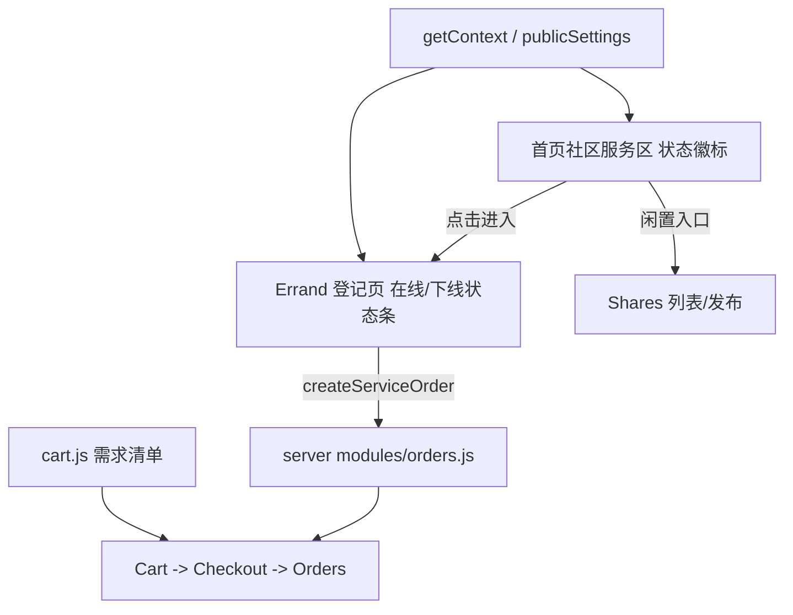

## 产品概述
对 h5 顾客端「爱尚里生活」做一次产品级重构：以 App 思维重做信息架构与页面结构，首页做减法、服务入口聚合、二级页去掉冗余返回按钮、统一间距与视觉体系。后端仅做"让服务真正可用"的最小开关调整。

## 核心问题（用户反馈）
- 二级页顶部有返回箭头按钮：与浏览器返回、底部 TabBar 三重冗余，不符合 App 习惯。
- 首页信息过载：免责 Banner、英文 eyebrow/kicker、"生活的小事，不用跑远"大标语与装饰插画、catalog-caption、bottom-note 等无用信息堆砌。
- 所有二级能力堆在一屏：服务、闲置、广场、商品目录全在首页；"我的"页又把个人资料、社区服务、配送规则、地址、订单混在 4 个分组里。
- 服务页（快递代取 / 便利店代买 / 二手闲置）全是"服务筹备中"的营销文案，真实下单页藏在别处，入口错配。
- 间距（gap）不统一：样式里零散手写 margin/padding，缺少 spacing scale。

## 核心功能（重构后）
1. **首页**：顶部只保留地址条（可切换）与「我的登记」入口；下方一个聚合的「社区服务」区，内含快递代取、便利店代买、邻里闲置全部入口，每项带在线/下线状态；再往下是便利铺商品（搜索 + 分类 + 网格）；底部浮动需求清单条。删除所有标语、装饰、重复提示。
2. **社区服务**：全部真实可用，点击直达登记页；状态统一展示"在线 / 下线 / 未开放"，由服务端配置驱动。
3. **二级页**：统一大标题页头 + 右侧操作，不再渲染返回箭头；流程页用「完成 / 取消」文字按钮或底部主 CTA 收口。
4. **我的**：头像卡 + 分组列表（我的登记 / 我的地址 / 我的发布）+ 单行说明 + 退出登录，去掉文艺大标题与重复文案。
5. **视觉与间距**：建立 spacing / radius / color tokens，统一区块间距、卡片圆角、列表行高与安全区处理。
6. **后端**：把三项服务默认开关开启并补齐必要配置，使前端不再显示"筹备中/暂未开放"。

## 不做的事
- 不动 `h5/src/lib/` 数据层与云函数调用方式，不重写后端业务接口。
- 不改 web 商家后台与小程序端。


## 技术栈
沿用现状，不引入新依赖：Vite + React 18（函数组件 + Hooks），自研 hash 路由 `h5/src/lib/router.js`，纯 CSS（`h5/src/styles.css`，rem + CSS 变量，rpx→rem 换算），云函数通过 `invoke(name, payload)` 调用。

## 实现思路
以"页面文件重写 + 样式 token 化"为主，`lib/` 数据层零改动；后端只改 `DEFAULT_SETTINGS` 默认开关。分五步推进，每步可独立验证，最后统一构建冒烟。

### 关键决策与权衡
1. **页头改造**：删除 `NavBar` 的返回箭头 → 新增 `PageHeader`（大标题 + 可选右侧 slot）。理由：H5 是 hash 路由单页，浏览器/手势返回天然可用，再加箭头属于第三重返回；App 习惯是"大标题 + 右操作"。代价：从分享链接直接进二级页时无显式返回，因此 TabBar 在三个 Tab 页常驻，非 Tab 页保留一个「返回首页」的兜底入口（文字按钮，非箭头）。
2. **服务入口聚合**：首页只放一个「社区服务」区（3 个入口），不再按功能分散。删除 `Service.jsx`（筹备中营销页），其"流程步骤 / 须知规则"折叠进 `Errand.jsx` 底部一个可展开的「服务说明」块，避免信息丢失。
3. **状态来源单一**：服务状态统一读 `getContext` → `publicSettings` 的 `enabled / configured`，映射为 在线 / 下线（非服务时段）/ 未开放（未配置）。不在前端写死"筹备中"。
4. **样式 token 化**：在 `:root` 增加 `--sp-1..8`、`--r-sm/md/lg`、`--section-gap`、`--row-h`，再把页面里的零散值替换为 token。不做 CSS-in-JS、不上 Tailwind，避免改动构建链。
5. **后端最小改动**：`expressEnabled / purchaseEnabled / secondhandEnabled` 默认置 `true`，`expressStations` 给默认站点列表，保证开箱可用；商家仍可用后台随时关成"下线"。

## 执行注意事项
- 性能：首页仍是单页长列表，保持现有 `loadProducts` 缓存 + `useCloudImages` 懒解析；商品图继续 `loading="lazy"`；闲置只取前 3 条（`listShares` 后 slice），不要因为新增服务区而增加请求。
- 兼容：`html { font-size: clamp(...) }` 与 `--app-w`（480/720/960/1120）响应式行为必须保留；宽屏下 TabBar 变顶部导航的现有 CSS 不能破坏。
- 安全区：`.screen-tabbed`、`dock`、浮动清单条依赖 `env(safe-area-inset-*)`，重写页头时保留 `sticky top:0` 与安全区 padding。
- 文案合规：免责声明从首页移除后，需在「我的」页底部保留一行简版说明（线下结算、不提供在线支付与交易担保），不能整体删除。
- 路由变更：`/service/:type` 移除后，需在 `App.jsx` 里同步处理旧链接（重定向到 `/errand/:type` 或 `/shares`），避免已分享链接 404。
- 爆炸半径：后端只动 `constants.js` 默认值；`settings.js / orders.js / routes.js` 不改。

## 架构与数据流


## 目录结构
```
h5/src/
├── styles.css                     # [MODIFY] 新增 spacing/radius/color tokens；重写 home、service、profile、navbar 等区块样式，统一 gap
├── components/
│   └── Layout.jsx                 # [MODIFY] 用 PageHeader（大标题+右操作）替换 NavBar 返回箭头；TabBar 保留并统一高度/安全区
├── App.jsx                        # [MODIFY] 删除 /service/:type 路由并做旧链重定向；页头/间距相关装配调整
├── pages/
│   ├── Home.jsx                   # [MODIFY 重写] 地址条 + 聚合服务区 + 商品区 + 浮动清单；删除标语/装饰/Banner/英文 eyebrow
│   ├── Service.jsx                # [DELETE] 筹备中营销页，内容折叠进 Errand 的「服务说明」
│   ├── Errand.jsx                 # [MODIFY 重写] 真实下单页：新页头、在线/下线状态条、底部可折叠服务说明、统一表单间距
│   ├── Profile.jsx                # [MODIFY 重写] 头像卡 + 分组列表（我的登记/我的地址/我的发布）+ 单行说明 + 退出
│   ├── Orders.jsx                 # [MODIFY] 换页头 + 间距 token（服务单/商品单合并列表逻辑不动）
│   ├── Cart.jsx / Checkout.jsx / Address.jsx   # [MODIFY] 换页头、间距 token、流程页用「完成」文字按钮收口
│   ├── Shares.jsx / ShareForm.jsx / ShareDetail.jsx  # [MODIFY] 换页头 + 间距；发布按钮收进闲置页内
│   ├── Forum.jsx / ForumPost.jsx / ForumDetail.jsx / ProfileEdit.jsx  # [MODIFY] 换页头 + 间距 token
└── lib/
    └── data.js                    # [MODIFY] 精简 services 文案（去掉与 UI 重复的 steps/rules 长文或改为折叠数据），新增状态文案映射
server/src/core/
└── constants.js                   # [MODIFY] DEFAULT_SETTINGS：expressEnabled/purchaseEnabled/secondhandEnabled 默认 true，expressStations 默认站点
```

## 关键结构（页头契约）
```jsx
// components/Layout.jsx
// PageHeader：大标题页头，无返回箭头；返回由系统手势/浏览器返回承担
// props: { title, subtitle?, right?: ReactNode, onClose?: () => void }
// TabBar：三个 Tab 常驻；非 Tab 页以文字「返回首页」兜底
```


## 设计风格
Apple HIG 移动端 App 风格：米白背景 + 深墨绿主色，分组卡片列表、大标题页头、紧凑信息密度、无装饰插画、无英文标语。整体克制、直达功能。

## 页面规划（4 屏）
1. **首页（社区）**：顶栏地址条（楼栋门牌 + 切换箭头，右侧「我的登记」图标）；「社区服务」区为 2 列卡片网格，每卡为图标 + 服务名 + 状态徽标（在线绿 / 下线灰）+ 一行价格或说明；下方商品区为搜索框 + 分类 chips + 2 列商品网格；底部浮动需求清单条。
2. **服务登记页（快递代取）**：大标题页头「快递代取」+ 右侧「说明」；在线/下线状态条；送达地址卡、站点选择 chips、包裹列表（支持短信粘贴识别）、备注、费用卡、底部固定主按钮「提交」。
3. **邻里闲置**：大标题 + 右侧「发布」；置顶一行筛选 chips；瀑布/网格卡片列表，卡片为图 + 标题 + 转让/免费标签 + 价格。
4. **我的**：头像 + 昵称卡（右侧「编辑」）；分组列表「我的登记 / 我的地址 / 我的发布」；底部一行简版说明与退出登录。

## 交互与间距
- 区块间距统一 24px，卡片内 16px，列表行高 52px，圆角 16px，分割线内缩至标题对齐。
- 卡片按下 0.96 缩放 + 背景微变，页面切换沿用现有 scroll-to-top 行为，无额外动画。
- 移动端优先（480 内容栏居中、安全区），宽屏保持内容栏居中不拉伸。

## Agent Extensions
### MCP
- **chrome-devtools**
  - Purpose：在 h5 本地预览中打开首页、服务登记页、我的页做冒烟验证（确认无返回箭头、服务入口与状态徽标正确、间距正常）
  - Expected outcome：三个页面渲染正常、无控制台报错、服务入口可点击进入登记页
### SubAgent
- **code-explorer**
  - Purpose：第一步枚举所有仍在用 `NavBar` 的页面与 `styles.css` 中零散间距值，确保替换无遗漏
  - Expected outcome：得到完整的 NavBar 调用点清单与待 token 化的样式区块清单
